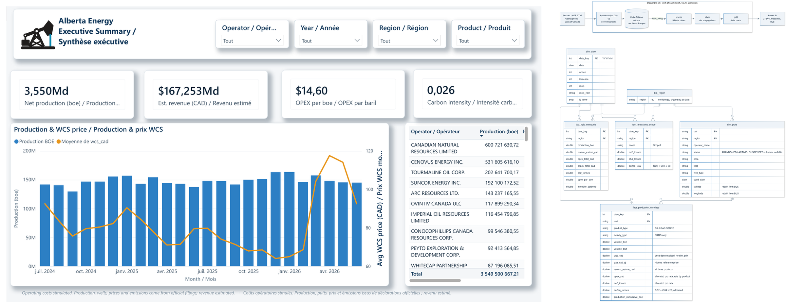
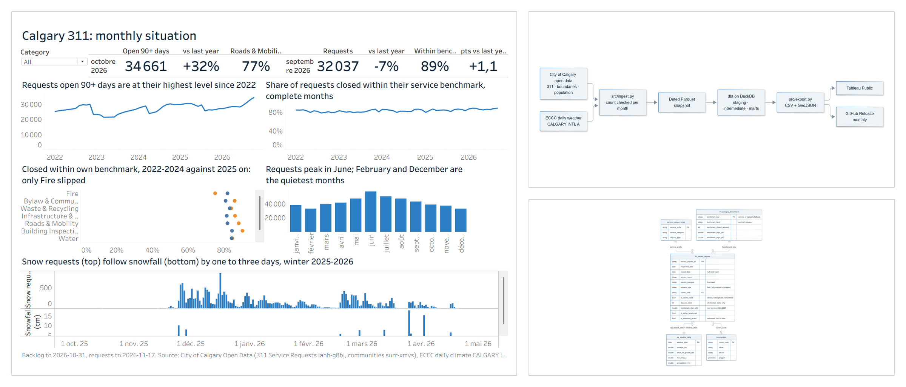

**Bilingual (English/French) data analyst**, moving to **Calgary, AB** (Canadian permanent residence in progress).
Master's in Computer Science and 2+ years building KPIs, Power BI dashboards and reports on finance, accounting and IT-operations data, in France and the US.

- SQL, Power BI (DAX) and Excel day to day; Python, dbt and Databricks for the pipelines behind the reports.
- Data quality habits: reconciliation, ServiceNow CMDB cleanup, plausibility tests that catch what structural tests miss.
- Requirements gathering with business stakeholders, recommendations to leadership.

  
  
  

![dbt](https://img.shields.io/badge/dbt-star%20schema-FF694B?logo=data%3Aimage%2Fsvg%2Bxml%3Bbase64%2CPHN2ZyBmaWxsPSJ3aGl0ZSIgcm9sZT0iaW1nIiB2aWV3Qm94PSIwIDAgMjQgMjQiIHhtbG5zPSJodHRwOi8vd3d3LnczLm9yZy8yMDAwL3N2ZyI%2BPHRpdGxlPmRidDwvdGl0bGU%2BPHBhdGggZD0iTTE3LjkwMDQgOS4zNzYzYTguMTQ4OCA4LjE0ODggMCAwIDAtMy4wNDIxLTMuMTIwNmwxLjc3MDguODM4NWExMC4yODc0IDEwLjI4NzQgMCAwIDEgMy43NCAzLjAwMDdsMy4yMzQtNS45Mjk1YTIuODU0NiAyLjg1NDYgMCAwIDAtLjA2MTEtMi45NjA0QzIyLjc1NjYuMDM3MSAyMS4yMTEyLS4zNDA5IDE5Ljk3NTQuMzMyN2wtNS44NzQ5IDMuMjEwMWE0LjM2MTIgNC4zNjEyIDAgMCAxLTQuMTc2MSAwTDQuMTc2OS40MDhhMi44NTQ1IDIuODU0NSAwIDAgMC0yLjk1OTIuMDYzMmMtMS4xNjczLjc4NTMtMS41NDUyIDIuMzMtLjg3MjMgMy41NjU1TDMuNTUgOS45MTA2YTQuMzYxMiA0LjM2MTIgMCAwIDEgMCA0LjE3NzJsLTMuMTI3MiA1Ljc0M2EyLjg2IDIuODYgMCAwIDAgLjA4NSAyLjk5NzRjLjc5NCAxLjE0MzggMi4zMjI1IDEuNTA1NCAzLjU0NDguODM4NWw2LjA1ODEtMy4zMDQ5YTEwLjI4NzcgMTAuMjg3NyAwIDAgMS0zLjAwNTEtMy43NDU0bC0uODM3NC0xLjc3MDhhOC4xNDggOC4xNDggMCAwIDAgMy4xMjA2IDMuMDQyMWwxMC41ODMyIDUuNzc5YzEuMjIxMy42NjYgMi43NDgxLjMwNTUgMy41NDI2LS44MzYzYTIuODY5OSAyLjg2OTkgMCAwIDAgLjA3OTYtMy4wMDE4TDE3LjkwMDQgOS4zNzYzem0zLjM4MDEtNy43MzUxYy42MDIyIDAgMS4wOTA0LjQ4ODIgMS4wOTA0IDEuMDkwNHMtLjQ4ODIgMS4wOTA0LTEuMDkwNCAxLjA5MDQtMS4wOTA0LS40ODgyLTEuMDkwNC0xLjA5MDQuNDg4Mi0xLjA5MDQgMS4wOTA0LTEuMDkwNHpNMi43NDQyIDMuODIyYy0uNjAyMiAwLTEuMDkwNC0uNDg4Mi0xLjA5MDQtMS4wOTA0cy40ODgyLTEuMDkwNCAxLjA5MDQtMS4wOTA0IDEuMDkwNC40ODgyIDEuMDkwNCAxLjA5MDRTMy4zNDY0IDMuODIyIDIuNzQ0MiAzLjgyMnptMCAxOC41MzYzYy0uNjAyMiAwLTEuMDkwNC0uNDg4Mi0xLjA5MDQtMS4wOTA0IDAtLjYwMjIuNDg4Mi0xLjA5MDQgMS4wOTA0LTEuMDkwNHMxLjA5MDQuNDg4MiAxLjA5MDQgMS4wOTA0YzAgLjYwMjItLjQ4ODIgMS4wOTA0LTEuMDkwNCAxLjA5MDR6bTEwLjM1ODUtMTEuNDQ4OWMtMS4yMDA4LS4wMDM1LTIuMTc3Ljk2NzItMi4xODA1IDIuMTY3OWEyLjE3MzggMi4xNzM4IDAgMCAwIC43MDUyIDEuNjA5MWMtMS40ODcyLS4yMDkxLTIuNTIzNC0xLjU4NDMtMi4zMTQyLTMuMDcxNi4yMDkxLTEuNDg3MiAxLjU4NDMtMi41MjM0IDMuMDcxNi0yLjMxNDJhMi43MTk0IDIuNzE5NCAwIDAgMSAyLjMxNDIgMi4zMTQyIDIuMTYyMyAyLjE2MjMgMCAwIDAtMS41OTYzLS43MDU0em04LjE3NzggMTEuNDQ4OWMtLjYwMjIgMC0xLjA5MDQtLjQ4ODItMS4wOTA0LTEuMDkwNCAwLS42MDIyLjQ4ODItMS4wOTA0IDEuMDkwNC0xLjA5MDRzMS4wOTA0LjQ4ODIgMS4wOTA0IDEuMDkwNGMwIC42MDIyLS40ODgyIDEuMDkwNC0xLjA5MDQgMS4wOTA0eiIvPjwvc3ZnPg%3D%3D)

## Featured projects

### [Alberta Energy Operations Intelligence](https://github.com/Nelson-Lefebvre/alberta-energy-bi)

Public Alberta oil and gas data (Petrinex production filings, the AER well register, WCS and gas prices; 4.34M fact rows),
ingested with Python into **Databricks** (Delta Lake, Unity Catalog), modelled with **dbt** into a star schema, refreshed by
a monthly job and reported in **Power BI** (27 DAX measures, row-level security). Production, prices and wells are real;
costs are simulated.

Two errors passed every structural test: a gas unit mismatch put one region's OPEX/boe at $4, and 11,943 wells carried
CO₂ with no production underneath. Grain-level plausibility tests now catch both.

### [Calgary 311 Service Performance](https://github.com/Nelson-Lefebvre/calgary-311-service-performance)

2.49M real City of Calgary 311 service requests (2022 onward), ingested with Python, modelled with **dbt** on DuckDB,
refreshed monthly by **GitHub Actions** and reported in **[Tableau Public](https://public.tableau.com/app/profile/nelson.lefebvre/viz/calgary_311)**. The City publishes no response-time targets,
so each service is judged against its own 2022-2024 benchmark: only Fire slipped, while field requests open 90+ days
rose 17% in four years.

Managed as an AI-assisted project with **Claude Code**: I owned the scope, KPIs and data rules, reviewed every change by
pull request and traced each number to a logged query. That review caught the AI inflating backlog growth to +48% (true
figure: +17%); every case is in the [AI log](https://github.com/Nelson-Lefebvre/calgary-311-service-performance/blob/main/docs/ai_log.md).

## Other projects

- **[LLM Dialect Drift Index (Louisiana French)](https://github.com/Nelson-Lefebvre/LLM-Dialect-drift-index-Louisiana)**:
  asked for Cajun forms, do LLMs keep them or drift to standard French? 8 linguistic variables, 720 generations,
  15 models from 3B to 550B parameters, with the statistical analysis published.
- **[Jeanne](https://github.com/Nelson-Lefebvre/Jeanne-AI-FMRADIO-ANALYSER-INTERNSHIP)**: offline voice assistant that
  reads live information from FM radio (RDS on a Raspberry Pi).

## Experience

| Role | Company | Years |
|---|---|---|
| IT Operations and Training | Alstom (international assignment), Rochester, NY, USA | 2024 - 2026 |
| Data Administrator: Risk & BI | Crédit Agricole, Vannes, France | 2024 |
| Data Analyst | Carrefour, Mondeville, France | 2023 |

## Education

M.Sc. Computer Science, Université de Caen Normandie (2021 - 2023; WES: equivalent to a Canadian Master's degree),
with an exchange year at the University of Nebraska at Omaha (2022).
