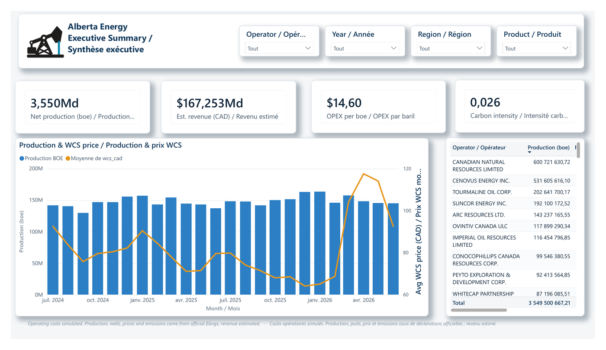

**Bilingual (English/French) data analyst**, moving to **Calgary, AB** (Canadian permanent residence in progress).
Master's in Computer Science and 2+ years building KPIs, Power BI dashboards and reports on finance, accounting and IT-operations data, in France and the US.

- SQL, Power BI (DAX) and Excel day to day; Python, dbt and Databricks for the pipelines behind the reports.
- Data quality habits: reconciliation, ServiceNow CMDB cleanup, plausibility tests that catch what structural tests miss.
- Requirements gathering with business stakeholders, recommendations to leadership.

  
  
  

  
  
  
  
  
  
  
  
  
  
  

## Featured project

### [Alberta Energy Operations Intelligence](https://github.com/Nelson-Lefebvre/alberta-energy-bi)

Public Alberta oil and gas data (Petrinex production filings, the AER well register, WCS and gas prices; 4.34M fact rows),
ingested with Python into **Databricks** (Delta Lake, Unity Catalog), modelled with **dbt** into a star schema, refreshed by
a monthly job and reported in **Power BI** (27 DAX measures, row-level security). Production, prices and wells are real;
costs are simulated.

Two errors passed every structural test: a gas unit mismatch put one region's OPEX/boe at $4, and 11,943 wells carried
CO₂ with no production underneath. Grain-level plausibility tests now catch both.

## Other projects

- **[LLM Dialect Drift Index (Louisiana French)](https://github.com/Nelson-Lefebvre/LLM-Dialect-drift-index-Louisiana)**:
  asked for Cajun forms, do LLMs keep them or drift to standard French? 8 linguistic variables, 720 generations,
  15 models from 3B to 550B parameters, with the statistical analysis published.
- **[Nebraska Storm Analysis](https://github.com/Nelson-Lefebvre/Artificial-intelligence-application-Storms-in-Nebraska)**:
  spatial and statistical analysis of 70 years of tornado records (1950-2021).
- **[Jeanne](https://github.com/Nelson-Lefebvre/Jeanne-AI-FMRADIO-ANALYSER-INTERNSHIP)**: offline voice assistant that
  reads live information from FM radio (RDS on a Raspberry Pi).

## Experience

| Role | Company | Years |
|---|---|---|
| IT Operations and Training | Alstom (international assignment), Rochester, NY, USA | 2024 - 2026 |
| Data Administrator: Risk & BI | Crédit Agricole, Vannes, France | 2024 |
| Data Analyst | Carrefour, Mondeville, France | 2023 |

## Education

M.Sc. Computer Science, Université de Caen Normandie (2021 - 2023; WES: equivalent to a Canadian Master's degree),
with an exchange year at the University of Nebraska at Omaha (2022).
